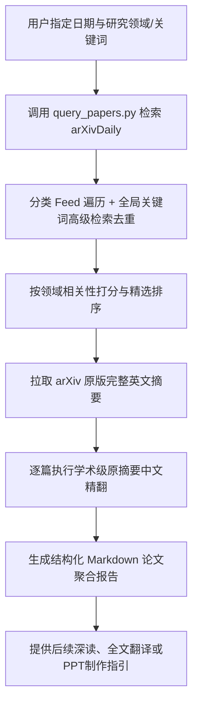

# ArXiv & ArXivDaily Paper Search Skill

本 Skill 旨在为用户提供**高度可定制化、跨学科、防遗漏**的每日学术论文检索与深度研读服务。支持用户自由输入感兴趣的研究领域关键词，自动在 arXiv / arXivDaily 上执行分类爬取与高级跨学科联合检索，按领域聚合、筛选高价值论文，并输出包含中英文标题、链接、学科分类、核心看点以及**原摘要完整高质量中文翻译**的学术卡片。

---

## 核心工作流 (Workflow)



---

### 第一步：明确检索参数 (Parameter Intake)

当用户请求查询某天或某些领域的论文时，检查并确认以下核心参数：
1. **目标日期 (Date)**：如 `2026-10-16`，或日期范围（默认当天或用户指定日期）。
2. **目标研究领域 / 关键词 (Domains & Keywords)**：
   - 用户可直接挑选预设领域：
     - `brain`：脑电 / 脑磁 / 脑机接口 / 神经解码 (EEG / MEG / BCI / Neural Decoding)
     - `rag`：大模型检索 / RAG / 向量检索 / 记忆检索 (RAG / Dense Retrieval / Memory)
     - `ie`：信息抽取 / 知识图谱 / 实体对齐 (IE / NER / Relation / Knowledge Graph)
     - `foundation`：大模型基础 / 预训练 / 推理 / 剪枝 / 量化 / 对齐 (LLM Foundation / Reasoning / Pruning / Quantization)
     - `agent`：智能体系统 / 工具调用 / 规划反思 (Agents / Tool Use / Planning)
     - `multimodal`：多模态大模型 / 视觉语言 / 音视频 (Multimodal / VLM)
     - `embodied`：具身智能 / 机器人大模型 (Embodied AI / Robotics)
   - **用户亦可任意输入自定义关键词**（如 `diffusion, audio generation, robotics, medical LLM` 等）。
3. **输出要求**：确认是否需要完整的原摘要中文翻译（默认提供高质量学术翻译）。

---

### 第二步：执行自动化检索脚本 (Run Retrieval)

在终端中运行内置的检索执行脚本 `query_papers.py`。该脚本会自动登录 arXivDaily 账号、遍历指定分类（如 `cs.CL` 等），并对所有指定关键词在全学科范围发起高级跨学科检索，最终自动拉取 arXiv 原版英文摘要：

```powershell
python "d:\antigravity\.agents\skills\arxiv-paper-search\scripts\query_papers.py" `
  --date "2026-10-16" `
  --domains "brain,rag,ie,foundation" `
  --keywords "custom_term1,custom_term2" `
  --fetch-abstracts `
  --output "d:\antigravity\arxiv_search_results.json"
```

> **参数说明**：
> - `--date`：目标日期（格式 `YYYY-MM-DD`）。
> - `--domains`：预设领域名称组合（如 `brain,rag,ie,foundation`）或自定义分类。
> - `--keywords`：补充的额外检索关键词。
> - `--fetch-abstracts`：自动从 `arxiv.org/abs/{aid}` 抓取未截断的完整原版英文摘要。
> - `--limit-per-domain`：每个领域精选论文上限（默认 15 篇）。

---

### 第三步：论文多维精选与排序 (Curation & Ranking)

脚本生成 JSON 结果后，审查每个领域的候选论文：
1. **相关性过滤**：剔除同形异义词干扰（如 "second brain"、"brainstorming" 等非神经科学内容）。
2. **质量与影响力**：优先挑选在方法创新、系统吞吐提升、理论分析或全新评测基准方面贡献突出的代表作。
3. **学科多样性**：兼顾计算机（CS）、电子工程/信号处理（EESS）、认知与神经生物学（q-bio）等交叉学科。

---

### 第四步：原摘要学术级中文翻译 (Abstract Translation)

针对入选论文的英文原摘要，进行**全段落、不省略、学术级**的中文翻译：
- 严格保持专业术语的学科规范表达（如：*Rotary Position Embedding* 译为“旋转位置嵌入/RoPE”、*Tokenization* 译为“标记化/分词”、*Eviction* 译为“驱逐/淘汰”、*Zero-shot* 译为“零样本”）。
- 对带有标号或特定段落格式的结构化摘要（如 `Objective`, `Approach`, `Main results`, `Significance`），完整保留其层次。
- 拒绝生硬机械翻译，确保语句通顺、符合中文学术阅读习惯。

---

### 第五步：标准化输出格式 (Output Format)

报告应按领域分组输出，每个领域清晰列出论文条目：

```markdown
# 一、[领域名称中文]（N 篇）

### 1. [英文论文标题]
* **中文标题**：[准确流畅的中文译名]
* **arXiv 链接**：https://arxiv.org/abs/[arXiv ID]
* **学科分类**：[cs.CL, cs.AI, ...]
* **核心看点**：[1-2句话凝练其核心痛点、所提方法及实验提升效果]
* **完整原摘要翻译**：
  > [原版英文摘要的全段学术级中文翻译，涵盖完整背景、方法、实验结果与学术意义]
```

---

### 第六步：后续联动 (Downstream Extensions)

在输出检索报告后，可主动引导用户进行下游操作：
- **全文翻译**：若用户对某篇具体论文感兴趣，可调用 `translate-paper-pdf-to-md` 技能将其 PDF 转换为精排版 Markdown 全文。
- **制作展示汇报**：若用户需要就某篇论文向团队或导师汇报，可调用 `codex-ppt` 或 `ppt-master` 技能快速生成论文讲解 PPT。
- **技术复现与代码审查**：协助用户下载对应开源仓库，解析核心实现模块。
